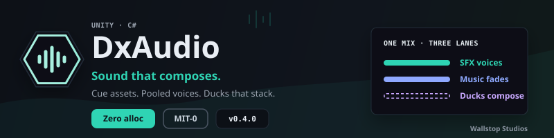
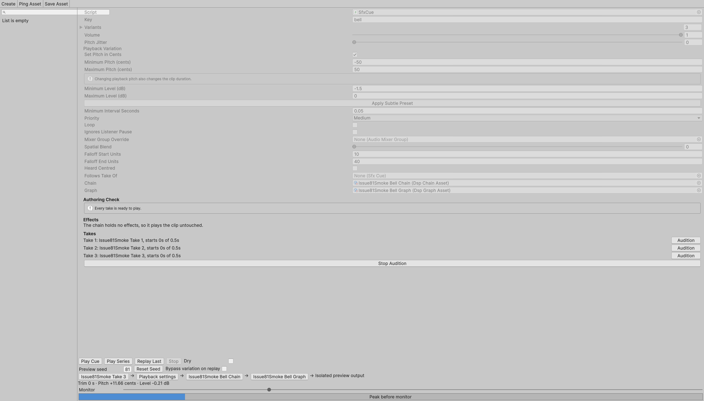
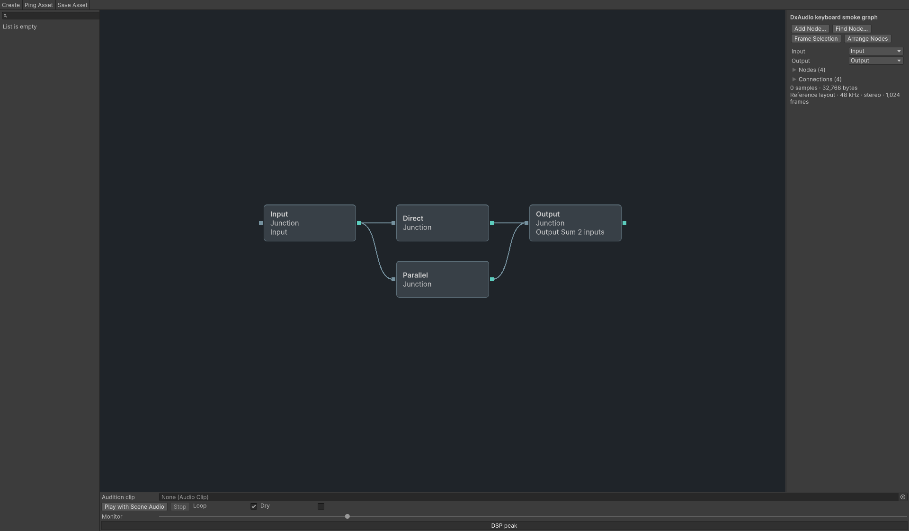

# DxAudio

<picture>
  <source media="(prefers-color-scheme: light)" srcset="https://raw.githubusercontent.com/Ambiguous-Interactive/DxAudio/main/docs/images/brand/dxaudio-banner-light.svg">
  
</picture>

[](Documentation~/index.md)
[](Documentation~/install.md)
[](Documentation~/install.md#from-npm)
[](Documentation~/install.md#from-openupm)
[](LICENSE.md)

Data-driven sound effects and music for Unity, with no package dependencies.

[Docs](Documentation~/index.md) |
[Quickstart](Documentation~/quickstart.md) |
[Editor tools](Documentation~/editor-tools.md) |
[Changelog](CHANGELOG.md) |
[Sample scene](Samples~/BasicUsage/README.md)

## 30-second tour

Give your players a cue keyed `door` and a music track with the context `level-1`. Assign a `MusicDuck` for dialogue.

<!-- snippet: unity members -->

```csharp
[SerializeField] private SfxPlayer _sfx;
[SerializeField] private MusicPlayer _music;
[SerializeField] private MusicDuck _dialogueDuck;
private MusicDuckLease _dialogue;

public void OpenDoor() => _sfx.Play("door");
public void EnterLevel() => _music.PlayContext("level-1");
public void BeginDialogue() => _dialogue = _music.Duck(_dialogueDuck, holder: this);
public void EndDialogue() => _music.Release(_dialogue);
```

The [quickstart](Documentation~/quickstart.md) shows how to create the assets and set up the scene.

## Install

DxAudio supports Unity 2021.3 and newer.

<details open>
<summary>OpenUPM</summary>

Run this command with the [OpenUPM CLI](https://openupm.com/docs/getting-started-cli.html).

```bash
openupm add com.wallstop-studios.dxaudio
```

</details>

<details>
<summary>npm registry</summary>

Add the registry and package to `Packages/manifest.json`.

```json
{
    "scopedRegistries": [
        {
            "name": "npmjs",
            "url": "https://registry.npmjs.org",
            "scopes": ["com.wallstop-studios"]
        }
    ],
    "dependencies": {
        "com.wallstop-studios.dxaudio": "0.4.0"
    }
}
```

</details>

<details>
<summary>Git URL</summary>

In Unity Package Manager, choose **+ > Add package from git URL**.

```text
https://github.com/Ambiguous-Interactive/DxAudio.git#v0.4.0
```

</details>

<details>
<summary>Tarball</summary>

Download the package tarball from [Releases](https://github.com/Ambiguous-Interactive/DxAudio/releases).
In Unity Package Manager, choose **+ > Add package from tarball**.

</details>

See the [install guide](Documentation~/install.md) for registry setup and sample availability.

## What you get

- **Cues.** Tune takes, pitch jitter, rate limits, priorities and 3D falloff in assets.
- **Voices.** Play from a fixed pool without allocating. Higher-priority cues can replace one-shots, and loops keep their voices.
- **Music.** Crossfade between contexts and play temporary overrides.
- **Ducks.** Lower and filter music for dialogue, menus and cutscenes. Active ducks compose.

## Editor tools

Open **Tools > Wallstop Studios > DxAudio > Authoring** to audition cues, edit DSP graphs and check libraries.

| Cue authoring                                                                                                                                                                                   | DSP graph                                                                                                                                                                               |
| ----------------------------------------------------------------------------------------------------------------------------------------------------------------------------------------------- | --------------------------------------------------------------------------------------------------------------------------------------------------------------------------------------- |
| [](Documentation~/editor-tools.md#authoring) | [](Documentation~/effects.md#a-node-graph) |

## Documentation

| I want to...                       | Go to                                                                                        |
| ---------------------------------- | -------------------------------------------------------------------------------------------- |
| Hear my first sound                | [Getting Started / Quickstart](Documentation~/quickstart.md)                                 |
| Duck music under dialogue          | [Guides / Ducks](Documentation~/ducks.md)                                                    |
| Understand why a voice gets stolen | [Concepts / Voice pool](Documentation~/cues.md#how-a-voice-is-chosen)                        |
| See active voices and ducks        | [Editor Tools / Play Mode diagnostics](Documentation~/editor-tools.md#play-mode-diagnostics) |
| Look up a field or message         | [Reference](Documentation~/index.md#reference)                                               |
| Fix a sound that did not play      | [Troubleshooting](Documentation~/troubleshooting.md)                                         |

Part of the Dx family. [DxMessaging](https://github.com/Ambiguous-Interactive/DxMessaging) |
[DxVisualizer](https://github.com/Ambiguous-Interactive/DxVisualizer) |
[DxTerminal](https://github.com/Ambiguous-Interactive/DxTerminal)

[MIT No Attribution](LICENSE.md). Extracted from [Isho Boy](https://github.com/Ambiguous-Interactive)'s audio system.

_Snippet compiled in CI._
